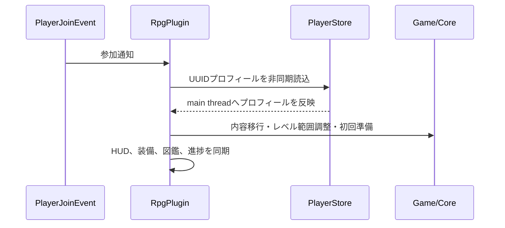

# EtherealChronicle の構成

この文書は、初めてコードを読む人が変更箇所とデータの流れを見つけるための案内です。ゲーム内の公開コマンド、YAML設定、プレイヤー保存形式は変更しません。

## パッケージ

- `core.*`: Bukkitに依存しないゲーム規則です。ステータス、戦闘、スキル、装備、依頼、会話、経済、パーティ、釣り・採取、ダンジョン用のモデルと計算を置きます。
- `data`: YAMLを安全に読み込み、文書を型付き定義へ変換し、参照・範囲・重複を検証します。`PlayerStore` はUUIDごとの保存、バックアップ、スキーマ移行を担当します。
- `paper.*`: Paper APIとの境界です。`RpgPlugin` が起動とイベントをつなぎ、各ControllerがNPC、敵、ダンジョン、採取、釣り、宝箱などの実体を管理します。
- `src/main/resources/content/<種類>/`: 配布するゲームデータです。初回起動時にデータフォルダーへコピーされ、以後はサーバー側の編集内容を尊重します。
- `src/test/kotlin`: coreの計算・移行・検証と、MockBukkitを使ったPaperイベントの回帰テストを置きます。

## 起動とコンテンツ読込

```mermaid
flowchart LR
  R[同梱YAMLとサーバー側content] --> L[ContentService / YAMLローダー]
  L --> V[型変換と参照検証]
  V --> S[ContentSnapshot]
  S --> P[RpgPluginと各Controller]
  A[/ec reload] --> L
```

起動時は同梱ファイルを不足分だけ配置し、サーバー側YAMLを優先して読み込みます。検証に成功したSnapshotを一括で公開するため、実行中に一部の定義だけが切り替わることはありません。`/ec validate` は読込結果を確認し、`/ec reload` は検証後にSnapshotを入れ替えます。

## プレイヤー参加と保存



`PlayerStore` は単一IOキュー上で読込・保存を直列化し、スナップショットを一時ファイルへ書いてから置換します。旧形式の追加フィールドはロード時にマイグレーションし、次回保存で現行schemaへ書き直します。Paperのプレイヤー・ワールド操作はメインスレッドへ戻してから行います。

## 取引と報酬

ショップ、依頼報酬、宝箱、強化などのアイテム・通貨操作は `AdventureController.transaction` を通します。

1. UUID単位のロックを取得し、プロフィールと所持品の変更前状態を控えます。
2. 消費アイテムを取り除き、通貨・進捗・保留報酬を更新します。
3. 強化のように所持品上の成果物がある場合、永続化前に対象へ適用します。
4. プロフィールを非同期保存し、成功後に保留報酬を配布します。
5. 保存失敗時は状態を戻し、切断時の未配布報酬はプロフィールのメールボックスへ残します。

この順序はクラッシュ時の二重付与を避けるためのものです。`player.saveData()` を伴う処理にもサーバー強制停止中の残余窓があり、実装コメントと `docs/RELEASE.md` の制約説明を確認してください。

## PaperイベントとController

- `RpgPlugin`: 起動、参加/退出、HUD、基本戦闘、コマンドをつなぐエントリーポイントです。
- `AdventureController`: NPC会話、ショップ、クエスト進行、パーティ、取引ロックと報酬配布を扱います。
- `EnemyController` / `DungeonController`: 管理対象の敵、ボス、ウェーブ、専用ワールド内のダンジョンを扱います。追跡対象を保持し、毎tick全エンティティを走査しません。
- `FishingController` / `GatheringController`: 有界セッションと短い周期処理で生活コンテンツを扱い、完了時にcore計算と既存取引経路へ結果を渡します。
- `TreasureController`: 宣言済み座標に表示を置き、claim時はonce flagと同一のプロフィール取引で報酬を確定します。
- `DemoWorld`: 所有マーカーを確認し、管理対象の `ec_world` のみを新規生成・バージョン移行します。未所有ワールドを変更しません。

## 変更時の目安

- 数式や条件を変える場合は `core.*` と単体テストを先に確認します。
- YAML型や参照を変える場合は `data`、`WorldContent`、`docs/CONTENT_SCHEMA.md` と実コンテンツ検証を確認します。
- イベント、GUI、ワールド実体を変える場合は該当Paper ControllerとMockBukkit回帰テストを確認します。
- 保存形式を変える場合は `PlayerStore` の移行段階と古いschema fixtureを必ず更新します。
- 経済・インベントリは取引ロック、保存順、pending reward、切断時復旧を維持します。
